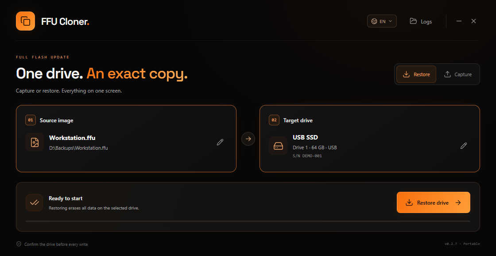

# FFU Cloner

[](https://github.com/EletroLaix/FFU-Cloner/releases/latest)


**A complete disk image, in one screen.** Capture and restore Windows Full Flash Update (FFU) images, follow progress and transfer speed, and inspect operation logs. Available in English, Italian, German, French, Spanish and Polish.

[**Download the latest installer**](https://github.com/EletroLaix/FFU-Cloner/releases/latest) · [Changelog](Documentation/Changelog.md)



*Interface preview with demonstration data.*

## Use

1. Install the MSI and launch FFU Cloner as administrator.
2. Choose **Capture** or **Restore**, then select the disk and FFU file.
3. Start the operation; confirm disk erasure when restoring.

**Restore overwrites the entire target disk.** The app protects system, boot and paging disks. Keep the app, image and logs on another disk, and close files on the selected disk. An interrupted restore must be repeated.

Requires Windows x64, DISM and Windows PowerShell 5.1 with the Storage module. Capture requires a **GPT** source and a new file on **NTFS or ReFS**, with at least 2 GiB free. Restore leaves the target offline; use Disk Management to bring it online if needed.

The installer is unsigned. Verify restored contents and bootability on the intended machine before production use.

## Build

With Node.js 24 and npm installed:

```powershell
npm ci
npm test
npm run package
```

The MSI is created in `Output/Installer`. Use `npm run start:build` to launch from source, or **F5** in Visual Studio Code. Run as administrator for physical-disk operations. See the [engine documentation](Documentation/Engine.md) for implementation details.

Developed by Marino Adriani, with artificial intelligence used as a development aid.
