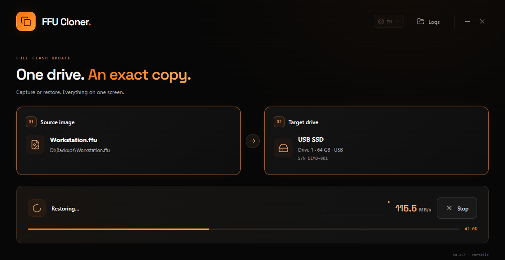

# FFU Cloner

**A complete disk image, in one screen.** FFU Cloner captures and restores Full Flash Update images with DISM through a focused desktop interface.

FFU Cloner is a private project developed by Marino Adriani. Artificial intelligence was used as an assistance tool during development.


_Image and disk selection with demonstration data._

## What it does

- **Capture a disk** to a compressed FFU file for storage or reuse.
- **Restore an image** to a physical disk after checking its model, capacity and serial number.
- Follow progress and measured transfer speed, or stop an operation when needed.
- Choose English, Italian, German, French, Spanish or Polish; the system language is detected automatically.



_Operation preview with demonstration data._

## How it works

1. Connect the disk and choose **Capture** or **Restore**.
2. Select the FFU file and the disk. No disk is selected automatically.
3. Start the operation. For a restore, review the summary and confirm disk erasure.

Restoring overwrites data and partitions. An interrupted restore leaves the disk incomplete and it must be restored again. An interrupted capture removes its temporary file after DISM exits; cleanup errors are reported. Use **Log** to inspect recent operation logs in the app or open their folder. The viewer refreshes automatically and shows the last 256 KiB of large files.

The app protects system, boot and paging disks, rechecks device identity, and ensures the app, image and logs are on another disk. Preparation takes the disk or its volumes offline; you may need to bring them online again using Disk Management.

## Requirements

Windows x64, DISM, Windows PowerShell 5.1 with the Storage module, and administrator privileges. Run the MSI installer to install the application and create desktop and Start menu shortcuts. The app requests UAC elevation when launched. FFU operations require Windows; this distribution does not support WinPE.

The installer places the Electron runtime on disk once. UAC, antivirus checks and disk discovery can still affect perceived startup time; disk discovery runs independently of the interface. The standard installer creates a desktop shortcut without asking; remove it if it is not needed.

For capture, choose a new file on NTFS or ReFS with at least 2 GiB free. The compressed image size does not indicate the minimum target disk capacity. Before deploying an image to production, verify its contents and bootability on the intended machine.

## Build

Install Node.js 24 and npm, then run:

```powershell
npm ci
npm test
npm run package
```

The MSI is created in `Output/Installer`. The Windows CI workflow builds the same package and uploads it as an artifact; it does not publish releases. Builds are unsigned unless signing is configured separately. Release publishing, version/tag policy, and signing credentials must be configured before public distribution.

`Master` holds the release baseline; ongoing development takes place on `Develop`. Both branches start from version 0.1.0.

Use `npm run start:build` to build and launch for development, then `npm start` to reopen the existing build without compiling it again. Use `npm run dev` for a browser preview with simulated data. Automated checks are available through `npm test`, `npm run test:ui`, and `npm run test:electron`. Run `npm run test:startup` to measure three interface launches with simulated, pending environment and disk queries. Set `FFU_APP_PATH` to an extracted `resources/app.asar` to check the packaged application code. These timings exclude ZIP extraction, UAC and physical disk discovery.

On Windows, open this folder in Visual Studio Code and press **F5** or choose **Run and Debug FFU Cloner**. The bundled configuration installs missing npm dependencies and builds the renderer with source maps before attaching debuggers to the Electron main process and React interface. Node.js and npm must be available on PATH; the renderer debugger uses local port 9223. Debugging runs with the privileges of Visual Studio Code: start VS Code as administrator when testing functionality that requires elevation.

## Project structure

- `Source/Application`: Electron window, IPC and the platform engine boundary; `Source/Application/Windows` contains the Windows and DISM implementation. See the [engine contract](Documentation/Engine.md).
- `Source/Interface`: React components, interface state and styles.
- `Source/Resources`: translations, images and fonts.
- `Scripts` and `Tests`: development tools and simulated checks.
- `Documentation`: presentation images and the [changelog](Documentation/Changelog.md).

Generated files stay in `Output`, which is excluded from Git. Automated checks use simulated data and processes; physical-disk validation requires suitable test hardware.
